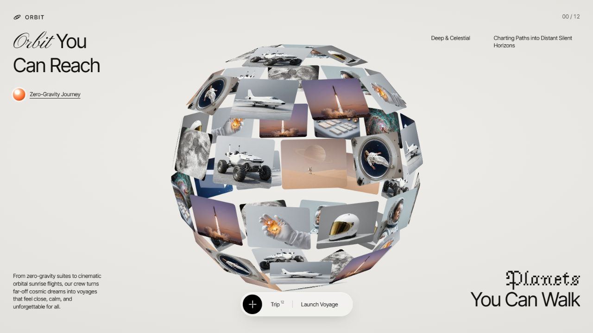

# Orbit · PhotoBall



**Orbit You Can Reach · Planets You Can Walk**

一个以太空旅行为主题的全屏交互页面。12 张太空影像分布在六个纬度环上，组成由 50 张卡片构成的 3D 照片球。拖动球体探索不同视角，点击卡片，镜头便会平滑推进，呈现近距离的星际画面。

HTML、CSS 和原生 JavaScript 全部包含在 `index.html` 中，无框架、无需构建。

## 设计与交互

- **立体照片球**：使用 CSS 3D 变换构建球面，支持自动旋转、指针视差和拖拽惯性。
- **沉浸式聚焦**：点击后将卡片旋转到正面并放大，邻近图片沿边缘展开；图片上不添加标题或图标。
- **浅色太空视觉**：暖灰渐变背景、书法体 Orbit、像素黑体 Planets，搭配底部玻璃质感导航。
- **渐进式入场**：球体从远处飞入，标题逐行上移，界面元素与图片渐显。
- **响应式适配**：支持桌面、手机竖屏和横屏；手机聚焦时隐藏主要文案，突出图片。
- **减少动态效果**：检测系统偏好，关闭自动旋转和部分文字入场过渡。

## 操作说明

| 操作 | 效果 |
| --- | --- |
| 鼠标拖拽或触摸滑动 | 旋转球体，松开后保留短暂惯性 |
| 点击图片卡片 | 聚焦并放大该卡片 |
| 聚焦时点击当前卡片或空白区域 | 返回球体视图 |
| 聚焦时点击另一张卡片 | 切换到该卡片 |
| 聚焦时按 `←` / `→` | 循环切换同一纬度环的上一张 / 下一张 |
| 按 `Esc` 或点击底部圆形按钮 | 返回球体视图 |
| 点击 `Trip` | 依次浏览赤道附近两圈的卡片 |
| 点击 `Launch Voyage` | 随机聚焦另一张卡片 |

右上角计数器显示当前图片在 12 张原图中的编号；球体总览状态显示 `00 / 12`。

## 本地运行

下载仓库后，直接用现代浏览器打开 `index.html`，无需安装依赖。

也可以在安装了 Python 3 的环境中启动本地静态服务器：

```sh
git clone https://github.com/ThreshoLdnnis/WebDesign10-PhotoBall.git
cd WebDesign10-PhotoBall
python -m http.server 8000 --bind 127.0.0.1
```

然后访问 [本地预览](http://127.0.0.1:8000)。

## 文件结构

```text
WebDesign10-PhotoBall/
├── index.html        # 完整页面，包含内联 CSS 与 JavaScript
├── README-cover.jpg  # 项目封面
└── README.md         # 项目说明
```

## 技术与资源

页面使用 CSS `perspective` / `preserve-3d`、Pointer Events 和 `requestAnimationFrame` 实现立体布局与动画，无外部 JavaScript 库。

- **字体**：Google Fonts 提供 Inter Tight、Pinyon Script 和 Jacquarda Bastarda 9。
- **图片**：通过指定的 CloudFront 地址加载 12 张 2048 × 1536 PNG 原图。
- **自定义**：可在 `index.html` 的 `:root` 中调整配色，在 `IMAGES`、`RINGS` 和 `SPIN` 中调整图片、球面排布与旋转速度。

字体与图片需要联网加载。原图体积较大，首次进入页面时，图片会随加载完成逐步显现。
